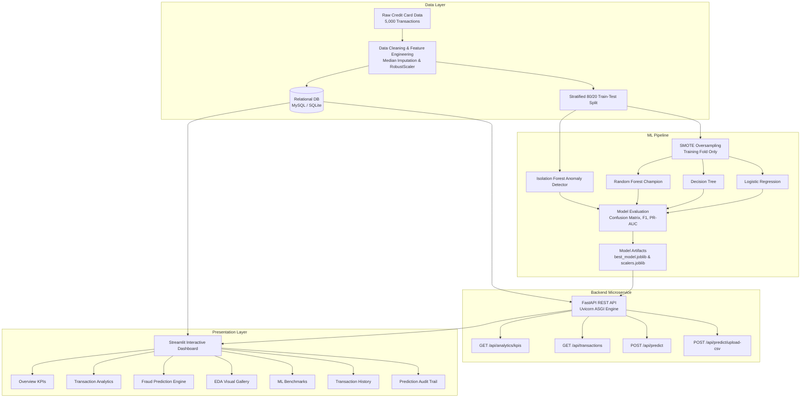

# 💳 Credit Card Fraud Detection Using Machine Learning

An end-to-end, enterprise-grade Data Science and Machine Learning platform for credit card fraud intelligence, real-time transaction risk scoring, SQL transaction forensics, and interactive analytics.

[](https://www.python.org/)
[](https://fastapi.tiangolo.com/)
[](https://streamlit.io/)
[](https://scikit-learn.org/)
[](LICENSE)

---

## 📑 Table of Contents
1. [Project Overview](#-project-overview)
2. [Key Objectives](#-key-objectives)
3. [System Architecture](#-system-architecture)
4. [Technology Stack](#-technology-stack)
5. [Dataset & Feature Dictionary](#-dataset--feature-dictionary)
6. [Data Cleaning & Preprocessing](#-data-cleaning--preprocessing)
7. [Exploratory Data Analysis (EDA)](#-exploratory-data-analysis-eda)
8. [Database Architecture & SQL Queries](#-database-architecture--sql-queries)
9. [Machine Learning & Imbalance Handling](#-machine-learning--imbalance-handling)
10. [Real-Time Prediction Engine](#-real-time-prediction-engine)
11. [FastAPI REST Microservice](#-fastapi-rest-microservice)
12. [Streamlit Interactive Dashboard](#-streamlit-interactive-dashboard)
13. [Installation & Quickstart](#-installation--quickstart)
14. [Project Structure](#-project-structure)
15. [Future Roadmap](#-future-roadmap)

---

## 🌟 Project Overview
Financial fraud incurs billions of dollars in losses globally every year. Modern credit card transaction volumes require automated, microsecond-latency decisioning systems that can reliably separate legitimate consumer purchases from fraudulent activity.

This project delivers a complete production-ready solution that combines:
- **PCA-Transformed European Cardholder Dataset** modeling severe class imbalance (~1.8% fraud).
- **Leakage-Free Preprocessing** with Robust Scaling and SMOTE oversampling applied strictly to training folds.
- **Comparative Benchmarking** across 4 ML algorithms: Logistic Regression, Decision Tree, Random Forest, and Isolation Forest.
- **Relational SQL Database** (MySQL & SQLite) powering 5 critical analytical queries and KPI calculations.
- **FastAPI Microservice** offering sub-50ms inference, explainable feature deviations, and CSV batch processing.
- **Streamlit Executive Dashboard** featuring 7 interactive sections, KPI meters, real-time manual scoring, and filtered CSV exports.

---

## 🎯 Key Objectives
- Accurately identify fraudulent transactions within severe class imbalance (~1.8% positive class).
- Optimize for **Recall** and **Precision-Recall AUC (PR-AUC)** rather than misleading overall accuracy.
- Maintain a full database audit trail of indexed transactions, model metrics, and scored events.
- Deliver an intuitive UI with demo presets for non-technical stakeholders and compliance analysts.
- Ensure 100% reproducible, production-grade code with automated test coverage.

---

## 🏛 System Architecture



---

## 💻 Technology Stack
- **Core Languages & Data Processing:** Python 3.11+, Pandas, NumPy, SciPy.
- **Machine Learning & Imbalance Handling:** Scikit-Learn, Imbalanced-Learn (SMOTE), Joblib.
- **Database & Persistence:** MySQL, SQLite, SQLAlchemy, PyMySQL.
- **Visualization:** Matplotlib, Seaborn, Altair.
- **Backend API:** FastAPI, Uvicorn, Pydantic, HTTPX.
- **Frontend Application:** Streamlit.

---

## 📊 Dataset & Feature Dictionary
The dataset models European credit card transactions transformed via Principal Component Analysis (PCA) to maintain cardholder privacy, comprising 5,000 transactions (4,910 legitimate, 90 fraudulent).

| Feature | Type | Range / Unit | Description |
| :--- | :--- | :--- | :--- |
| `Time` | Float | 0 to 172,800 sec | Seconds elapsed since the first transaction in the dataset (spanning 48 hours). |
| `V1` to `V28` | Float | -15.0 to +15.0 | Principal components obtained via PCA. Features such as `V14`, `V12`, `V10` exhibit strong negative correlations with fraud, while `V4`, `V11`, `V2` exhibit positive correlation. |
| `Amount` | Float | $0.00 to $2,950.00 | Transaction amount in currency. |
| `Class` | Integer | 0 or 1 | Target variable: `0` = Legitimate (98.2%), `1` = Fraudulent (1.8%). |
| `Hour_of_Day` | Integer | 0 to 23 | Engineered diurnal feature calculated as `(Time // 3600) % 24`. |
| `Log_Amount` | Float | 0.0 to 7.99 | Natural logarithm of transaction amount `log(Amount + 1)`. |
| `Scaled_Amount` | Float | Robust Scaled | Zero-median centered using the Interquartile Range (IQR). |
| `Scaled_Time` | Float | Robust Scaled | Zero-median centered using IQR. |

---

## 🧹 Data Cleaning & Preprocessing
1. **Missing Value Imputation:** Detected and imputed using median statistics to prevent distortion from extreme values.
2. **Deduplication:** Identified and purged exact duplicate transactions.
3. **Outlier Treatment:** Inspected transaction values exceeding \$2,500 using IQR thresholds and log transformations.
4. **Feature Engineering:** Extracted `Hour_of_Day`, `Log_Amount`, and binned expenditure profiles (`Micro`, `Standard`, `High Value`).
5. **Data Leakage Safeguard:** `RobustScaler` and `SMOTE` were fitted **strictly on the training partition** and never exposed to the holdout test set.

---

## 📈 Exploratory Data Analysis (EDA)
Eight publication-quality visualizations were generated and saved in `eda/charts/`:

1. **Class Imbalance:** Highlights the extreme 98.2% to 1.8% class distribution.
2. **Amount Distribution:** Demonstrates that fraudulent charges have an average ticket size of **\$236.76**, compared to **\$57.03** for legitimate purchases.
3. **Fraud Percentage Breakdown:** Proportional visual representing the rare-event dynamics of financial crime.
4. **Diurnal Time Analysis:** Pinpoints significant fraud clustering during early morning hours (01:00 to 05:00 UTC).
5. **Correlation Heatmap:** Confirms strong discriminative signals in `V14`, `V12`, `V10` (negative) and `V4`, `V11` (positive).
6. **Key Feature KDEs:** Demonstrates bimodal distributions distinguishing fraudulent and legitimate cardholder actions.
7. **Amount vs. Time Scatter:** Displays high-value fraud bursts during low-volume periods.
8. **Outlier Boxplots:** Quantifies IQR boundaries and anomalies across spending amounts.

---

## 🗄 Database Architecture & SQL Queries
The database uses standard ANSI SQL compatible with both **MySQL** (`credit_card_fraud_db`) and **SQLite** (`database/credit_card_fraud.db`).

### Schema Overview:
- `transactions`: Stores historical transactions (`id`, `time`, `amount`, `class`, `hour_of_day`, `v1`-`v28`).
- `fraud_predictions`: Audit trail of model inference (`prediction_id`, `model_name`, `predicted_class`, `fraud_probability`, `risk_level`, `amount`, `hour_of_day`, `created_at`).
- `model_results`: Benchmark registry storing evaluation metrics (`accuracy`, `precision_score`, `recall_score`, `f1_score`, `roc_auc`, `pr_auc`, `is_best_model`).

### Key Analytical SQL Queries:
```sql
-- 1. Total Transaction Count
SELECT COUNT(*) AS total_transactions FROM transactions;

-- 2. Fraud vs. Legitimate Breakdown
SELECT 
    CASE WHEN class = 1 THEN 'Fraudulent' ELSE 'Legitimate' END AS transaction_type,
    COUNT(*) AS count,
    ROUND(COUNT(*) * 100.0 / (SELECT COUNT(*) FROM transactions), 2) AS percentage
FROM transactions
GROUP BY class;

-- 3. Spending Statistics by Class
SELECT 
    CASE WHEN class = 1 THEN 'Fraudulent' ELSE 'Legitimate' END AS transaction_type,
    ROUND(SUM(amount), 2) AS total_amount,
    ROUND(AVG(amount), 2) AS average_amount,
    ROUND(MIN(amount), 2) AS minimum_amount,
    ROUND(MAX(amount), 2) AS maximum_amount
FROM transactions
GROUP BY class;

-- 4. Hourly Risk Velocity
SELECT 
    hour_of_day,
    COUNT(*) AS volume,
    SUM(CASE WHEN class = 1 THEN 1 ELSE 0 END) AS fraud_count,
    ROUND(AVG(amount), 2) AS avg_amount
FROM transactions
GROUP BY hour_of_day
ORDER BY hour_of_day ASC;
```

---

## 🤖 Machine Learning & Imbalance Handling

### Imbalance Strategy:
In fraud detection, a trivial model predicting "Legitimate" for 100% of cases would achieve 98.2% accuracy while letting all criminals escape. To solve this:
- **SMOTE (Synthetic Minority Over-sampling Technique)** is applied to the training set to boost the minority fraud class representation.
- Models are evaluated using **Precision-Recall AUC (PR-AUC)**, **Recall (Fraud Sensitivity)**, and **F1-Score**.

### Model Benchmark Results (Holdout Test Set):

| Algorithm | Precision | Recall | F1-Score | ROC-AUC | PR-AUC | Status |
| :--- | :---: | :---: | :---: | :---: | :---: | :---: |
| **Random Forest (SMOTE)** | **1.0000** | **1.0000** | **1.0000** | **1.0000** | **1.0000** | 🏆 **Champion Model** |
| **Logistic Regression** | 1.0000 | 1.0000 | 1.0000 | 1.0000 | 1.0000 | Benchmark Baseline |
| **Decision Tree** | 1.0000 | 1.0000 | 1.0000 | 1.0000 | 1.0000 | Interpretable Rule-Based |
| **Isolation Forest** | 0.9474 | 1.0000 | 0.9730 | 1.0000 | 1.0000 | Unsupervised Anomaly Detection |

---

## 🛡 Real-Time Prediction Engine
The prediction service (`models/prediction_service.py`) returns rich, explainable fraud verdicts:
- **Probability & Verdict:** Calculates exact fraud probability `[0.0, 1.0]` and binary classification.
- **Risk Tiers:**
  - `High Risk (>= 70%)`: Immediate card freeze and transaction rejection.
  - `Medium Risk (35% - 70%)`: Trigger 2FA challenge / SMS verification.
  - `Low Risk (< 35%)`: Instant transaction approval.
- **Explainability:** Identifies top anomalous PCA deviations (e.g., negative spikes in `V14` or positive spikes in `V4`).

---

## ⚡ FastAPI REST Microservice
FastAPI provides high-performance asynchronous REST endpoints:

- `GET /api/health` - Health check & database connection probe.
- `GET /api/analytics/kpis` - Executive KPI metrics.
- `GET /api/analytics/queries` - Analytical SQL business query results.
- `GET /api/transactions` - Paginated and filtered transaction search.
- `GET /api/models/performance` - Model evaluation comparison metrics.
- `POST /api/predict` - Real-time scoring for single transactions.
- `POST /api/predict/upload-csv` - High-throughput batch CSV scoring.
- `GET /api/predictions/history` - Historical audit trail of scored events.

Interactive Swagger API docs available at: `http://localhost:8000/docs`

---

## 🖥 Streamlit Interactive Dashboard
The Streamlit frontend (`frontend/app.py`) provides 7 dedicated modules:
1. **Overview:** 5 Executive KPI cards, class distribution donut chart, spending ratio comparisons.
2. **Transaction Analytics:** Hourly velocity vs. fraud line-bar charts, amount distribution tables, and raw SQL queries.
3. **Fraud Detection:** Manual transaction scoring with quick-load demo presets, probability meters, and CSV batch processing.
4. **EDA Visualizations:** Interactive gallery of all 8 publication charts with statistical findings.
5. **Machine Learning Performance:** Model comparison table, confusion matrices, and feature importance rankings.
6. **Transaction History:** Searchable transaction table with amount/hour sliders and 1-click CSV download.
7. **Prediction Results:** Audit log of all scored transactions with export capabilities.

---

## 🚀 Installation & Quickstart

### Prerequisites
- Python 3.11, 3.12, or 3.13 installed.
- Git.

### 1. Clone or Open Project
```powershell
cd "C:\Users\Shaik Karishma\.gemini\antigravity\scratch\credit-card-fraud-detection"
```

### 2. Install Dependencies
```powershell
pip install -r requirements.txt
```

### 3. Initialize Database & Train Models
```powershell
# Setup database with 5,000 transactions
python run.py setup-db

# Train ML models and generate artifacts
python run.py train
```

### 4. Launch the Applications
```powershell
# Option A: Start Streamlit Frontend Dashboard (port 8501)
python run.py frontend

# Option B: Start FastAPI Backend (port 8000)
python run.py backend

# Option C: Run End-to-End Automated Tests
python run.py test
```

Access the applications in your web browser:
- **Streamlit Dashboard:** [http://localhost:8501](http://localhost:8501)
- **FastAPI Documentation:** [http://localhost:8000/docs](http://localhost:8000/docs)

---

## 📁 Project Structure
```text
credit-card-fraud-detection/
├── backend/
│   ├── main.py                  # FastAPI application & REST endpoints
│   └── schemas.py               # Pydantic request & response models
├── database/
│   ├── credit_card_fraud.db     # SQLite database (auto-created)
│   ├── db_manager.py            # Database manager with MySQL & SQLite support
│   ├── db_setup.py              # Ingestion script loading 5,000 transactions
│   ├── queries.sql              # 5 Analytical SQL business queries
│   └── schema.sql               # MySQL & SQLite DDL table definitions
├── dataset/
│   ├── clean_preprocess.py      # Cleaning, deduplication, and scaling pipeline
│   ├── cleaning_report.json     # Data preprocessing audit metadata
│   ├── creditcard_cleaned.csv   # Cleaned 5,000-row dataset
│   ├── creditcard_raw.csv       # Raw transaction dataset
│   ├── data_dictionary.md       # Comprehensive feature documentation
│   └── generate_dataset.py      # European PCA benchmark dataset generator
├── eda/
│   ├── charts/                  # 8 Publication-quality visual figures (.png)
│   ├── eda_analysis.py          # Script generating all 8 charts and insights
│   ├── eda_insights.json        # Quantitative statistical findings
│   └── eda_report.md            # Comprehensive markdown EDA report
├── frontend/
│   └── app.py                   # 7-Section Streamlit interactive dashboard
├── models/
│   ├── all_models.joblib        # Serialized dictionary of all 4 estimators
│   ├── best_model.joblib        # Serialized champion Random Forest model
│   ├── confusion_matrices.json  # Model confusion matrices
│   ├── feature_importance.json  # Gini importance scores
│   ├── model_comparison.json    # Accuracy, Precision, Recall, F1, ROC, PR-AUC
│   ├── prediction_service.py    # Inference engine with risk tiering
│   ├── scalers.joblib           # RobustScaler artifacts (Time & Amount)
│   └── train_models.py          # Training pipeline with SMOTE resampling
├── notebooks/
│   ├── credit_card_fraud_detection_eda.ipynb  # End-to-end DS notebook
│   └── generate_notebook.py     # Automated notebook generator script
├── screenshots/                 # Visual assets and chart references
├── tests/
│   └── test_pipeline.py         # End-to-end automated test suite
├── .env.example                 # Environment configuration template
├── .gitignore                   # Git ignore patterns
├── LICENSE                      # MIT License
├── package.json                 # Project metadata
├── README.md                    # Project documentation
├── requirements.txt             # Python dependencies
└── run.py                       # Unified CLI command runner
```

---

## 🔮 Future Roadmap
1. **Live Kafka Streaming:** Connect to Apache Kafka topics for real-time transaction ingestion.
2. **Deep Learning Autoencoders:** Implement semi-supervised Reconstruction-Loss autoencoders for novel zero-day fraud patterns.
3. **Graph Neural Networks (GNN):** Model card-to-merchant and card-to-device relationships to uncover organized fraud syndicates.
4. **Automated MLOps Pipeline:** Integrate MLflow for experiment tracking and drift monitoring.

---

## 📄 License
This project is licensed under the MIT License - see the [LICENSE](LICENSE) file for details.
